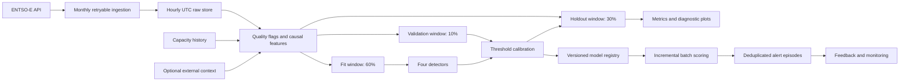

# ENTSO-E Renewable Forecast-Error Anomaly Detector

[](https://www.python.org/)
[](https://pytorch.org/)
[](https://transparency.entsoe.eu/)
[](#license)

A reproducible research and operations framework for detecting unusual hourly
wind-and-solar forecast errors in the German bidding zone. The repository
compares causal statistical, robust, tree-based, and sequence models; evaluates
them with chronological holdouts and rolling-origin backtests; and provides an
idempotent batch-scoring and monitoring path.

> **Scientific interpretation.** The bundled target is a statistical proxy
> derived from renewable forecast error, not an independently adjudicated grid
> incident label. Consequently, the reported classification metrics quantify
> agreement with that proxy rule. They must not be interpreted as evidence of
> real-world incident-detection accuracy or causal operational benefit.

## Abstract

Day-ahead renewable-generation forecasts are inputs to power-system scheduling,
reserve planning, and market operations. Forecast errors are heteroscedastic,
seasonal, and technology-dependent: a deviation that is exceptional during a
low-generation period may be routine during a high-wind episode. This project
studies whether four unsupervised or weakly calibrated anomaly detectors can
identify statistically unusual hourly forecast errors from German ENTSO-E wind
and solar data.

The workflow constructs 24 causal features from actual and forecast generation,
ramp errors, trailing statistics, installed-capacity normalization, and cyclic
calendar encodings. Models are fitted on the first 60% of observations,
decision thresholds are selected exclusively on the next 10%, and final metrics
are computed on the last 30%. A four-fold expanding-window experiment measures
seasonal stability. The strongest holdout result is obtained by a robust
median-absolute-deviation detector (F1 = 0.784), while Isolation Forest provides
the strongest less-directly-coupled multivariate result (F1 = 0.583). The LSTM
autoencoder exhibits substantial seasonal threshold transfer failure (F1 =
0.201 and 911 alerts on 2,571 holdout hours).

The repository also includes retryable monthly ingestion, explicit data-quality
flags, versioned and checksummed model artifacts, atomic scoring state, alert
episode deduplication, operator feedback, and freshness/alert-rate/drift
monitoring. The result is both a research benchmark and a transparent prototype
for scheduled anomaly-screening operations.

## Research questions and contributions

The implementation addresses four questions:

1. **Baseline strength:** how far can causal rolling statistics go before a
   multivariate or sequential model is justified?
2. **Temporal generalization:** do thresholds calibrated in one part of the year
   transfer to later seasonal regimes?
3. **Evaluation integrity:** how do results change when fitting, calibration,
   and testing are separated chronologically rather than evaluated in-sample?
4. **Operational reproducibility:** can the trained system be versioned, scored
   incrementally, monitored, and reviewed without changing research semantics?

The main contributions are:

- a leak-resistant hourly feature pipeline with strictly historical rolling
  windows;
- a documented proxy-label construction and explicit separation between proxy
  agreement and independent outcome validation;
- a 60/10/30 chronological protocol plus four expanding-window seasonal folds;
- comparison of rolling z-score, robust MAD, Isolation Forest, and an LSTM
  autoencoder;
- validation-only alert-threshold calibration;
- optional contracts for weather, load, net-import, and independent event data;
- a dependency-light operational layer with immutable manifests, artifact
  checksums, idempotent upserts, alert episodes, feedback, and monitoring.

## System overview



The research and operational paths share the same feature contract and
calibrated artifacts. Production-like scoring therefore does not silently use
a different preprocessing or thresholding implementation from the benchmark.

## Data

### Source and scope

Generation actuals and day-ahead wind/solar forecasts are retrieved from the
[ENTSO-E Transparency Platform](https://transparency.entsoe.eu/) through
`entsoe-py`. The configured bidding zone is `DE_LU`; the queried production
types are solar (`B16`), wind offshore (`B18`), and wind onshore (`B19`). Raw
timestamps are converted to UTC and stored as timezone-naive hourly timestamps
for stable joins and parquet serialization.

The committed result artifacts were generated from the locally available 2023
extract. After rolling-window warm-up, the processed benchmark contains 8,568
hourly rows from **2023-01-07 23:00 UTC** through **2023-12-30 22:00 UTC**. The
gap relative to a complete calendar year is a source-coverage limitation of the
stored extract, not an implicit imputation claim. New ingestion runs use an
exclusive `2024-01-01` endpoint and construct the expected UTC hourly index for
each monthly chunk.

### Ingestion and quality controls

`src/fetch.py` performs monthly requests with exponential retry, normalizes API
responses to hourly series, and preserves four row-level quality variables:

| Field | Meaning |
|---|---|
| `quality_source_missing_count` | Number of missing source values before limited imputation |
| `quality_imputed_count` | Number of values filled by the two-hour forward-fill rule |
| `quality_unresolved_count` | Number of source values still missing after imputation |
| `quality_is_complete` | One only when all required source values are available |

Aggregate wind and renewable values use `min_count`; a missing component is not
silently replaced by zero. This is important because zero generation and
unavailable telemetry are scientifically different states.

### Installed capacity and optional context

Normalization uses date-effective values from
[`config/capacity_history.csv`](config/capacity_history.csv), rather than
embedding capacity constants in feature code. The included 2023 project
assumption is 66 GW wind and 73 GW solar and should be replaced or extended when
the analysis period changes.

Optional context is accepted through the contract in
[`data/external/README.md`](data/external/README.md). Supported fields include
temperature, wind speed, irradiance, actual/forecast load, and net imports.
Missingness indicators are retained. These external series are not bundled,
because the project does not invent unavailable weather or incident evidence.

## Problem formulation

For hour \(t\), technology-specific forecast error is

$$
e_{k,t} = A_{k,t} - F_{k,t}, \qquad k \in \{\text{wind},\text{solar}\},
$$

where \(A\) denotes observed generation and \(F\) denotes the corresponding
forecast. Total renewable error is

$$
e_t = (A_{\text{wind},t} + A_{\text{solar},t})
      - (F_{\text{wind},t} + F_{\text{solar},t}).
$$

Capacity-normalized errors divide by the installed capacity effective at hour
\(t\):

$$
\tilde e_{k,t} = \frac{e_{k,t}}{C_{k,t}}.
$$

The task is *contemporaneous detection*: the system identifies an unusual
forecast miss once actual generation for that hour is available. It is not a
multi-hour-ahead predictor of a future imbalance.

### Proxy anomaly label

No human-adjudicated anomaly labels are included. The benchmark proxy compares
the current absolute total error \(a_t = |e_t|\) with the strictly preceding
720-hour reference window:

$$
\mu_t = \operatorname{mean}(a_{t-720:t-1}), \qquad
\sigma_t = \operatorname{sd}(a_{t-720:t-1}),
$$

$$
z_t^{\text{proxy}} = \frac{a_t - \mu_t}{\sigma_t}, \qquad
y_t = \mathbb{1}[z_t^{\text{proxy}} > 2].
$$

At least 168 historical hours are required. The current processed set contains
465 proxy-positive hours (5.4%). The current observation is shifted out of its
own reference distribution, preventing a large value from diluting its score.

This label is useful for regression testing and controlled model comparison,
but it creates **construct coupling**: z-score and MAD detectors consume the
same forecast-error family from which the target is derived. Their high AUC or
F1 therefore cannot establish external validity.

## Causal feature engineering

Every rolling statistic is shifted by one hour. No feature at time \(t\) reads
future observations, and trailing context excludes the current target hour.

| Group | Features | Count |
|---|---|---:|
| Signed errors | `wind_error_mw`, `solar_error_mw`, `total_error_mw` | 3 |
| Capacity-normalized errors | `wind_error_norm`, `solar_error_norm`, `total_error_norm` | 3 |
| Ramps | `wind_ramp_mw`, `solar_ramp_mw`, `ramp_error_mw` | 3 |
| Trailing context | 24 h error mean/std, 168 h mean, 24 h maximum absolute error | 4 |
| Calendar indicators | hour, month, season, night, weekend | 5 |
| Cyclic encodings | sine/cosine pairs for hour, week, and year | 6 |
| **Total** |  | **24** |

The ramp-error feature compares total actual renewable ramp with total forecast
renewable ramp. Cyclic encodings avoid artificial discontinuities such as hour
23 being numerically distant from hour 0.

## Models

### 1. Rolling z-score

The statistical baseline computes a causal one-week rolling z-score of
`total_error_norm`, then uses its absolute value as the anomaly score. It is
transparent, inexpensive, and intentionally difficult to beat when the proxy
target is itself error-based.

### 2. Robust median absolute deviation

For absolute forecast error \(a_t\), the robust score is

$$
s_t^{\text{MAD}} =
\max\left(0,\frac{0.67449(a_t - \operatorname{median}(H_t))}
{\operatorname{median}(|H_t-\operatorname{median}(H_t)|)}\right),
$$

where \(H_t\) is the trailing 720-hour history. The median and MAD reduce the
influence of extreme observations relative to mean and standard deviation.

### 3. Isolation Forest

The multivariate detector uses 200 isolation trees, contamination 0.05, and
random seed 42. The model is fitted only on the fit window. Higher anomaly
scores correspond to easier isolation in feature space. The method follows the
isolation principle introduced by Liu, Ting, and Zhou [1].

### 4. LSTM autoencoder

The sequence model consumes 24-hour windows of all registered features:

```text
Encoder:  LSTM(input_dim=24, hidden_dim=32)
Context:  final encoder hidden state repeated for 24 steps
Decoder:  LSTM(32, 32) -> Linear(32, 24)
Score:    final-timestep mean squared reconstruction error
Training: 30 epochs, Adam, learning rate 0.001, batch size 64, seed 42
```

The first 23 rows have no complete context window and receive no finite score.
The architecture uses the LSTM recurrence introduced by Hochreiter and
Schmidhuber [2]. Training is unsupervised; only the decision threshold uses
validation proxy labels.

## Experimental design

### Chronological split

Random shuffling would allow later seasonal regimes to influence earlier model
development. The primary experiment therefore preserves time order:

| Partition | Rows | Period | Purpose |
|---|---:|---|---|
| Fit | 5,141 | 2023-01-07 23:00 – 2023-08-10 03:00 | Fit scaler, Isolation Forest, and LSTM |
| Validation | 856 | 2023-08-10 04:00 – 2023-09-14 19:00 | Select one threshold per model |
| Holdout | 2,571 | 2023-09-14 20:00 – 2023-12-30 22:00 | Final comparison only |

For each model score \(s_t\), the threshold is selected by maximizing validation
F1:

$$
\tau^* = \arg\max_{\tau} F_1\left(y^{\text{val}},
\mathbb{1}[s^{\text{val}} \ge \tau]\right).
$$

The holdout is not used to fit model parameters or thresholds.

### Rolling-origin evaluation

`run_backtest.py` creates four expanding fit windows. Every fold has a later
validation interval and a non-overlapping test interval. Z-score, MAD, and
Isolation Forest are evaluated by default; LSTM can be included with
`--include-lstm` because repeated sequence training is substantially slower.

### Metrics

Reported metrics are precision, recall, F1, ROC-AUC, and number of flagged
hours. ROC-AUC is computed only when finite scores and both target classes are
present. For a positive class of proxy anomalies:

$$
\operatorname{precision}=\frac{TP}{TP+FP},\qquad
\operatorname{recall}=\frac{TP}{TP+FN},
$$

$$
F_1 = 2\frac{\operatorname{precision}\cdot\operatorname{recall}}
{\operatorname{precision}+\operatorname{recall}}.
$$

## Results

### Final chronological holdout

| Model | Precision | Recall | F1 | ROC-AUC | Flagged hours | Calibrated threshold |
|---|---:|---:|---:|---:|---:|---:|
| **Robust MAD** | **0.965** | **0.661** | **0.784** | **0.997** | 113 | 3.7028 |
| Isolation Forest | 0.538 | 0.636 | 0.583 | 0.952 | 195 | 0.0108 |
| Rolling z-score | 0.879 | 0.176 | 0.293 | 0.974 | 33 | 3.2933 |
| LSTM autoencoder | 0.119 | 0.655 | 0.201 | 0.685 | 911 | 1.0123 |

The holdout contains 165 proxy-positive hours. Full-precision values and split
metadata are stored in
[`results/metrics/anomaly_results.csv`](results/metrics/anomaly_results.csv).

### Four-fold rolling-origin summary

| Model | Precision, mean ± SD | Recall, mean ± SD | F1, mean ± SD | ROC-AUC, mean ± SD |
|---|---:|---:|---:|---:|
| **Robust MAD** | **0.941 ± 0.056** | **0.856 ± 0.226** | **0.879 ± 0.134** | **0.999 ± 0.001** |
| Rolling z-score | 0.649 ± 0.214 | 0.672 ± 0.109 | 0.632 ± 0.044 | 0.978 ± 0.008 |
| Isolation Forest | 0.502 ± 0.150 | 0.730 ± 0.245 | 0.552 ± 0.092 | 0.964 ± 0.013 |

Fold-level dates, thresholds, and metrics are available in
[`backtest_folds.csv`](results/metrics/backtest_folds.csv); aggregate values are
in [`backtest_summary.csv`](results/metrics/backtest_summary.csv).

### Interpretation

- **Robust MAD closely reproduces the proxy construct.** Its strong metrics are
  useful evidence that robust local scale is stable, but they are not evidence
  of independent incident detection.
- **Isolation Forest is the strongest multivariate model on holdout F1.** Its
  ranking remains strong across folds, although threshold transfer changes the
  precision/recall balance.
- **The calibrated z-score becomes conservative in the final seasonal regime.**
  Its high ROC-AUC and low recall show that ranking quality and binary operating
  point quality are distinct questions.
- **The LSTM is poorly calibrated across seasons.** It flags 35.4% of holdout
  hours. Complexity does not compensate for distribution shift, limited data,
  or a proxy target dominated by instantaneous error magnitude.
- **Simple baselines are essential.** On this dataset, the statistical and
  robust methods are more competitive than the neural model.

## Diagnostic figures

### Holdout forecast error


The blue series is total actual minus forecast renewable generation. Red bands
mark proxy-positive intervals. Only holdout timestamps are plotted.

### Model alert comparison


Rows show each model's binary decisions. Dark overlays denote simultaneous
agreement across all four models.

### Confusion matrices


These matrices compare model decisions with proxy labels—not adjudicated grid
events.

### LSTM reconstruction error


The dense above-threshold region makes the LSTM's seasonal transfer problem
visible.

### Hour-by-month alert pattern


Blank months lie outside the final holdout. Color intensity is the fraction of
hours flagged within each observed month/hour cell.

## Operational architecture

Research training registers immutable versions under
`models/registry/<run_id>/`. Each manifest records:

- SHA-256 hashes for model artifacts and the feature parquet;
- exact ordered feature names and training-reference statistics;
- calibrated thresholds and validation score quantiles;
- fit/validation/test boundaries and evaluation metrics;
- package versions, creation time, label column, and Git revision.

`run_operational.py` then performs an idempotent scheduled batch:

1. rebuild causal features from the current raw store;
2. atomically upsert features by timestamp;
3. verify registered artifact checksums;
4. score only timestamps newer than persisted state;
5. upsert scores by `(timestamp, model, model_version)`;
6. combine nearby positive hours into alert episodes;
7. assign low/medium/high/critical severity from validation score references;
8. retain operator feedback; and
9. refresh JSON status and a dependency-free HTML dashboard.

The dashboard reports source freshness, per-model alert rate, and standardized
feature-mean drift. Calendar drift is informational because seasonal movement
is expected. The bundled historical dataset correctly reports critical
freshness when run today.

See [`docs/OPERATIONS.md`](docs/OPERATIONS.md) for scheduling, rollback,
feedback, and recovery procedures.

## Reproduction

### Requirements

- Python 3.10 or newer;
- an ENTSO-E Transparency Platform API token for new ingestion;
- CPU execution is supported; CUDA is used automatically for LSTM training when
  available.

### Installation

```powershell
git clone https://github.com/MhdAsker/entso-renewable-anomaly-detector.git
Set-Location entso-renewable-anomaly-detector

python -m venv .venv
.\.venv\Scripts\Activate.ps1
python -m pip install --upgrade pip
pip install -r requirements.txt

Copy-Item .env.example .env
# Add ENTSOE_API_KEY=<token> to .env
```

### Research pipeline

```powershell
# 1. Fetch monthly chunks and write data/raw/entso_raw.parquet
python src/fetch.py

# 2. Build causal features and proxy labels
python src/features.py

# 3. Fit 60%, calibrate 10%, evaluate 30%, plot, and register artifacts
python run_detector.py --run-id germany-2023-v1

# 4. Run four expanding-window folds
python run_backtest.py

# Optional: include repeated LSTM training in the backtest
python run_backtest.py --include-lstm --epochs 10
```

For a fast code-path smoke test without registering a weak one-epoch model:

```powershell
python run_detector.py --epochs 1 --skip-plots --no-register
```

### Operational batch

```powershell
python run_operational.py --model-version germany-2023-v1

# Repeating with unchanged raw data produces zero new scores
python run_operational.py --model-version germany-2023-v1
```

Record expert review against a generated alert:

```powershell
python record_feedback.py EVENT_ID true_positive `
  --notes "Confirmed against an independent operational record"
```

### Verification

```powershell
python -m unittest discover -s tests -v
python check_status.py
```

The current suite contains 15 tests covering causal label construction, ramp
alignment, sequence alignment, threshold calibration, date-effective capacity,
retry behavior, rolling folds, independent-label contracts, atomic idempotent
storage, cross-batch alert deduplication, feedback, and state persistence.

## Repository structure

```text
entso-renewable-anomaly-detector/
├── config/
│   └── capacity_history.csv
├── data/
│   ├── external/                  # contracts/examples; no fabricated sources
│   ├── raw/                       # ignored reproducible API extract
│   └── processed/                 # ignored engineered parquet
├── docs/
│   ├── IMPROVEMENT_PLAN.md
│   └── OPERATIONS.md
├── models/
│   └── registry/                  # ignored immutable local model versions
├── results/
│   ├── metrics/
│   └── plots/
├── src/
│   ├── models/
│   │   ├── iforest_model.py
│   │   ├── lstm_autoencoder.py
│   │   ├── robust_model.py
│   │   └── zscore_model.py
│   ├── alerts.py
│   ├── backtest.py
│   ├── capacity.py
│   ├── context.py
│   ├── evaluate.py
│   ├── features.py
│   ├── fetch.py
│   ├── labels.py
│   ├── monitoring.py
│   ├── registry.py
│   ├── scoring.py
│   ├── storage.py
│   └── visualize.py
├── tests/
├── check_status.py
├── record_feedback.py
├── register_current.py
├── run_backtest.py
├── run_detector.py
└── run_operational.py
```

## Independent outcome labels

The preferred next validation step is to attach a timestamped outcome series
from an independently governed source—for example, reviewed reserve-activation
events, imbalance-price excursions with a pre-registered definition, or expert
incident annotations. The required CSV schema is `timestamp,is_event`.

```python
from src.labels import attach_event_labels

features = attach_event_labels(features, "data/external/event_labels.csv")
```

Then evaluate without changing the detector implementation:

```powershell
python run_detector.py --label-column event_label --run-id external-label-v1
python run_backtest.py --label-column event_label
```

Label provenance, inclusion rules, timestamp semantics, and adjudication policy
should be versioned beside the file.

## Threats to validity and limitations

1. **Proxy-target circularity.** The target and several detector scores share
   forecast-error inputs. Robust MAD and z-score results are therefore expected
   to be optimistic relative to an independent outcome.
2. **Single-zone, single-period evidence.** Results from Germany/Luxembourg in
   the stored 2023 extract may not generalize to other bidding zones, years,
   capacity mixes, forecast providers, or market regimes.
3. **Incomplete stored calendar coverage.** The committed metrics do not cover
   every hour of calendar year 2023.
4. **No causal operational outcome.** The study does not show that acting on an
   alert reduces balancing cost, reserve activation, or reliability risk.
5. **Detection, not forecasting.** Actual generation is required to construct
   the core error features. Alerts are contemporaneous diagnostics.
6. **Threshold instability.** Validation-optimal F1 thresholds depend on class
   prevalence and season. The LSTM result demonstrates this sensitivity.
7. **Limited hyperparameter search.** Model configurations are controlled
   comparisons, not exhaustive optimizations. Searching on the final holdout
   would invalidate the protocol.
8. **Capacity assumptions.** The included capacity history is a project
   assumption and must be replaced with authoritative dated values for a new
   research claim.
9. **Optional covariates absent.** Weather, load, and cross-border fields are
   supported but not present in the bundled benchmark.
10. **Operational prototype scope.** Local parquet and CSV state are suitable
    for a transparent scheduled prototype, not concurrent distributed writers.

## Future research

- validate against independently reviewed grid and market outcomes;
- expand to multiple bidding zones and multiple years;
- replace project capacity assumptions with authoritative dated series;
- add numerical weather prediction, load, interconnector, and curtailment data;
- quantify calibration with precision-recall curves, expected alert burden, and
  cost-sensitive utility rather than F1 alone;
- evaluate conformal, extreme-value, change-point, and probabilistic residual
  methods;
- use nested rolling-origin model selection to avoid optimistic tuning;
- evaluate event-level detection delay and episode precision in addition to
  hour-level metrics;
- compare static, seasonal, and adaptive thresholds under concept drift; and
- study whether a predictive model can provide useful lead time before actual
  generation becomes available.

## Reproducibility artifacts

| Artifact | Purpose |
|---|---|
| [`anomaly_results.csv`](results/metrics/anomaly_results.csv) | Full holdout metrics and thresholds |
| [`backtest_folds.csv`](results/metrics/backtest_folds.csv) | Per-fold dates, thresholds, and metrics |
| [`backtest_summary.csv`](results/metrics/backtest_summary.csv) | Across-fold mean and standard deviation |
| [`IMPROVEMENT_PLAN.md`](docs/IMPROVEMENT_PLAN.md) | Three-phase technical evolution |
| [`OPERATIONS.md`](docs/OPERATIONS.md) | Scheduling, state, feedback, and rollback |
| [`tests/`](tests/) | Regression tests for research and operational invariants |

Raw and processed parquet files, secrets, trained binaries, registry versions,
and mutable runtime state are intentionally excluded from Git.

## References

1. F. T. Liu, K. M. Ting, and Z.-H. Zhou, “Isolation Forest,” *2008
   Eighth IEEE International Conference on Data Mining*, pp. 413–422, 2008.
   [doi:10.1109/ICDM.2008.17](https://doi.org/10.1109/ICDM.2008.17)
2. S. Hochreiter and J. Schmidhuber, “Long Short-Term Memory,” *Neural
   Computation*, vol. 9, no. 8, pp. 1735–1780, 1997.
   [doi:10.1162/neco.1997.9.8.1735](https://doi.org/10.1162/neco.1997.9.8.1735)
3. ENTSO-E, “Transparency Platform.”
   [https://transparency.entsoe.eu/](https://transparency.entsoe.eu/)

## Citation

If this repository is used in academic work, cite the repository and record the
exact Git commit, model-registry run ID, feature-file hash, label definition,
and evaluation period. A suggested software citation is:

```bibtex
@software{asker_entso_renewable_anomaly_detector,
  author  = {MhdAsker},
  title   = {ENTSO-E Renewable Forecast-Error Anomaly Detector},
  url     = {https://github.com/MhdAsker/entso-renewable-anomaly-detector},
  year    = {2026},
  note    = {Research benchmark and operational prototype}
}
```

## License

Released under the MIT License. ENTSO-E data use remains subject to the source
platform's applicable terms and attribution requirements.
