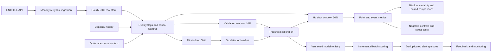
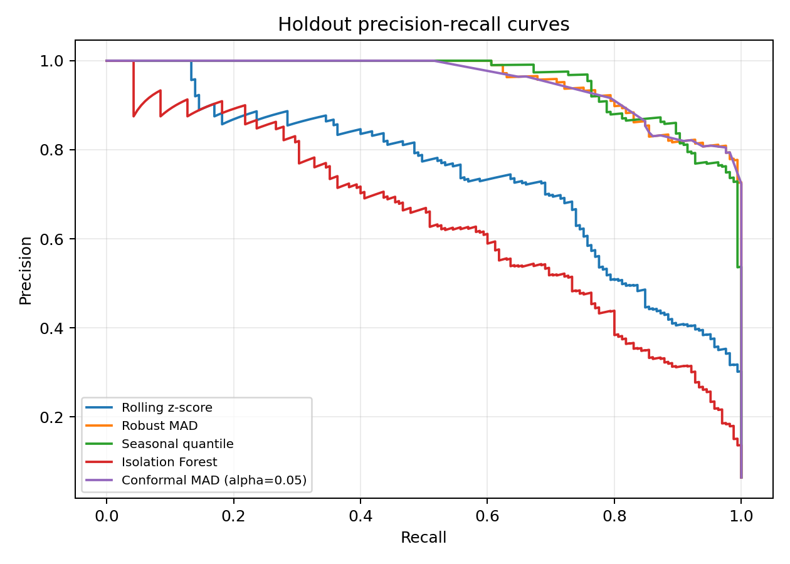
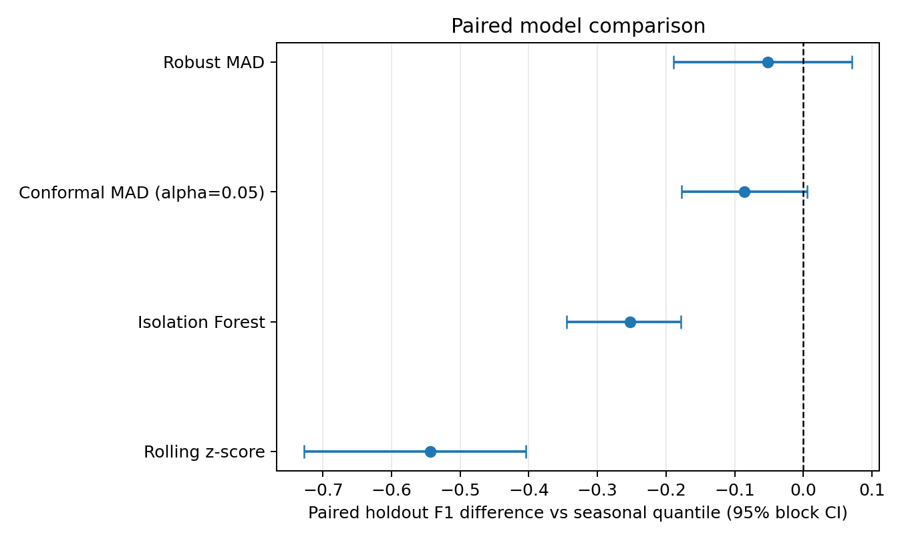
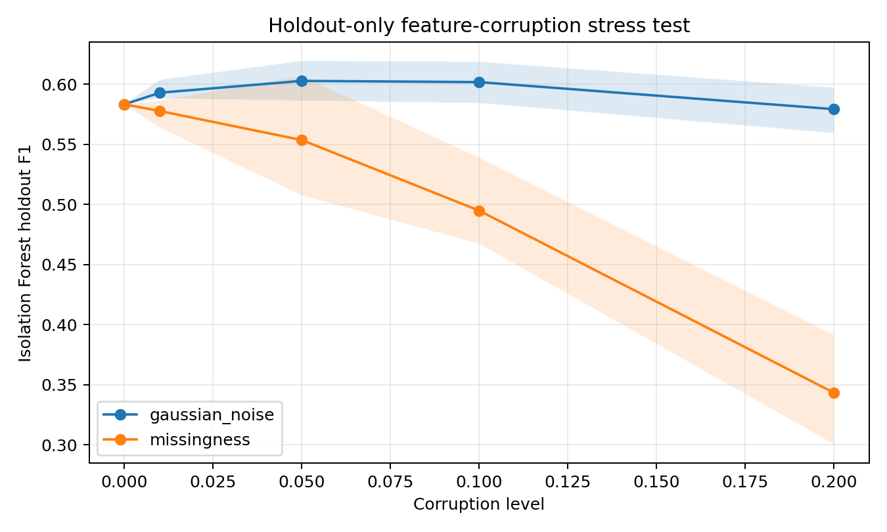

# ENTSO-E Renewable Forecast-Error Anomaly Detector

[](https://www.python.org/)
[](https://pytorch.org/)
[](https://transparency.entsoe.eu/)
[](#verification)
[](#scientific-claim-boundary)
[](#license)

A reproducible research and operations framework for detecting unusual hourly
wind-and-solar forecast errors in the Germany/Luxembourg bidding zone. The repository
compares causal statistical, robust, tree-based, and sequence models; evaluates
them with chronological holdouts and rolling-origin backtests; and provides an
idempotent batch-scoring and monitoring path.

> **Scientific interpretation.** The bundled target is a statistical proxy
> derived from renewable forecast error, not an independently adjudicated grid
> incident label. Consequently, the reported classification metrics quantify
> agreement with that proxy rule. They must not be interpreted as evidence of
> real-world incident-detection accuracy or causal operational benefit.

## Abstract

Day-ahead renewable-generation forecasts support power-system scheduling,
reserve planning, and electricity-market operations. Their errors are strongly
seasonal, heteroscedastic, and dependent on installed capacity, making a fixed
global anomaly rule difficult to justify. This repository presents a
reproducible study of contemporaneous wind-and-solar forecast-error anomaly
detection using hourly ENTSO-E data for Germany/Luxembourg in 2023.

The pipeline constructs 24 leakage-controlled features from generation errors,
ramps, trailing statistics, capacity normalization, and cyclic calendar terms.
Six detector families are studied: rolling z-score, robust median absolute
deviation (MAD), seasonal conditional quantiles, Isolation Forest, an LSTM
autoencoder, and split-conformal calibration of MAD scores. The primary design
uses a chronological 60/10/30 fit/calibration/holdout split. Complementary
evidence includes four expanding-window folds, one-to-one event metrics without
point adjustment, 168-hour moving-block uncertainty intervals, paired model
comparisons, feature ablations, circular-shift negative controls with Holm
correction, threshold-policy sensitivity, cost-utility scenarios, and seeded
feature-corruption experiments.

On the fixed proxy-label holdout, seasonal quantile achieves the highest F1
(0.836; 95% block-bootstrap interval 0.757–0.901) and event F1 (0.833). Robust
MAD achieves F1 0.784 with only 1.12 false alerts per 30 days and is the most
stable method across rolling folds (mean F1 0.879; worst fold 0.683). The paired
F1 difference between robust MAD and seasonal quantile is unresolved
(-0.052; 95% interval -0.189 to 0.071). Isolation Forest is significantly worse
than seasonal quantile on paired F1 and degrades from 0.583 to 0.343 under 20%
feature missingness. The LSTM demonstrates marked threshold-transfer failure.

These results are agreement with an internal forecast-error proxy—not verified
grid incidents or causal operational value. The repository therefore combines
positive results with explicit claim boundaries, evidence-level contracts, and
a catalog-driven path toward multi-zone, multi-year, independently governed
validation. It also supplies a versioned scheduled-batch prototype with atomic
state, alert episodes, feedback, and monitoring.

## Results at a glance

| Question | Evidence | Result |
|---|---|---|
| Best fixed-holdout detector | 2,571-hour chronological holdout | Seasonal quantile: F1 0.836, event F1 0.833 |
| Best temporal-transfer detector | Four expanding-window folds | Robust MAD: F1 0.879 ± 0.134; worst fold 0.683 |
| Lowest alert burden among strong models | Fixed holdout | Robust MAD: 1.12 false alerts per 30 days |
| Does robust MAD differ from seasonal quantile? | 500 paired 168-hour bootstraps | Unresolved: ΔF1 -0.052 (-0.189, 0.071) |
| Does Isolation Forest differ from seasonal quantile? | Same paired bootstrap | Worse: ΔF1 -0.253 (-0.345, -0.178) |
| Are results timestamp-specific? | 500 circular label shifts, 10 Holm-corrected tests | All adjusted p = 0.01996 |
| Is the multivariate detector robust to missing inputs? | 20 seeded repeats per corruption level | Isolation Forest F1 falls 41% at 20% missingness |
| Has external validity been demonstrated? | Dataset/evidence catalog | **No**: one zone-year, internal proxy labels only |

## Scientific claim boundary

This repository supports different claims at different evidence levels:

| Claim | Status | Basis |
|---|---|---|
| The code paths are reproducible and regression-tested | Supported | Deterministic seeds, hashes/manifests, 32 tests, generated artifacts |
| Several methods detect the project's forecast-error proxy | Supported for the stored DE_LU 2023 extract | Chronological holdout, rolling folds, event metrics, uncertainty analysis |
| Robust MAD is more temporally stable than the other tested methods | Supported descriptively on this dataset | Four rolling folds, worst-fold and threshold-stability analysis |
| The detector recognizes independently governed grid incidents | **Not established** | No authorized independent outcome dataset is currently active |
| Results generalize across years, zones, or market regimes | **Not established** | The catalog currently contains one active zone-year |
| Acting on an alert improves cost or reliability | **Not established** | Utility coefficients are scenarios, not observed intervention outcomes |

The negative controls reject accidental timestamp alignment, but they do not
remove construct coupling between the proxy label and forecast-error features.
Similarly, high ROC-AUC or PR-AUC is ranking evidence, not proof that a chosen
threshold transfers across seasons.

## Research questions and contributions

The implementation addresses seven questions:

1. **Baseline strength:** how far can causal rolling statistics go before a
   multivariate or sequential model is justified?
2. **Temporal generalization:** do thresholds calibrated in one part of the year
   transfer to later seasonal regimes?
3. **Evaluation integrity:** how do results change when fitting, calibration,
   and testing are separated chronologically rather than evaluated in-sample?
4. **Operational reproducibility:** can the trained system be versioned, scored
   incrementally, monitored, and reviewed without changing research semantics?
5. **Uncertainty:** do paired serial-dependence-aware intervals support apparent
   differences between detectors?
6. **Robustness:** how sensitive are conclusions to threshold policy, assumed
   costs, input corruption, and deliberately broken timestamp alignment?
7. **External validity:** can the same locked protocol be applied across a
   catalog of zones, years, and independently governed outcomes?

The main contributions are:

- a leak-resistant hourly feature pipeline with strictly historical rolling
  windows;
- a documented proxy-label construction and explicit separation between proxy
  agreement and independent outcome validation;
- a 60/10/30 chronological protocol plus four expanding-window seasonal folds;
- comparison of rolling z-score, robust MAD, seasonal quantiles, conformal MAD,
  Isolation Forest, and an LSTM autoencoder;
- validation-only alert-threshold calibration;
- point and event metrics without point adjustment, PR-AUC/MCC, alert burden,
  moving-block intervals, and paired comparisons;
- negative controls, threshold/cost sensitivity, feature ablation, and
  corruption stress tests;
- a validated dataset/evidence catalog that rejects unsupported provenance
  claims and can execute every active replication dataset;
- optional contracts for weather, load, net-import, and independent event data;
- a dependency-light operational layer with immutable manifests, artifact
  checksums, idempotent upserts, alert episodes, feedback, and monitoring.

## System overview



The research and operational paths share the same feature contract and
calibrated artifacts. Production-like scoring therefore does not silently use
a different preprocessing or thresholding implementation from the benchmark.

## Data

### Source and scope

Generation actuals and day-ahead wind/solar forecasts are retrieved from the
[ENTSO-E Transparency Platform](https://transparency.entsoe.eu/) through
`entsoe-py`. The configured bidding zone is `DE_LU`; the queried production
types are solar (`B16`), wind offshore (`B18`), and wind onshore (`B19`). Raw
timestamps are converted to UTC and stored as timezone-naive hourly timestamps
for stable joins and parquet serialization.

The committed result artifacts were generated from the locally available 2023
extract. After rolling-window warm-up, the processed benchmark contains 8,568
hourly rows from **2023-01-07 23:00 UTC** through **2023-12-30 22:00 UTC**. The
gap relative to a complete calendar year is a source-coverage limitation of the
stored extract, not an implicit imputation claim. New ingestion runs use an
exclusive `2024-01-01` endpoint and construct the expected UTC hourly index for
each monthly chunk.

### Ingestion and quality controls

`src/fetch.py` performs monthly requests with exponential retry, normalizes API
responses to hourly series, and preserves four row-level quality variables:

| Field | Meaning |
|---|---|
| `quality_source_missing_count` | Number of missing source values before limited imputation |
| `quality_imputed_count` | Number of values filled by the two-hour forward-fill rule |
| `quality_unresolved_count` | Number of source values still missing after imputation |
| `quality_is_complete` | One only when all required source values are available |

Aggregate wind and renewable values use `min_count`; a missing component is not
silently replaced by zero. This is important because zero generation and
unavailable telemetry are scientifically different states.

### Installed capacity and optional context

Normalization uses date-effective values from
[`config/capacity_history.csv`](config/capacity_history.csv), rather than
embedding capacity constants in feature code. The included 2023 project
assumption is 66 GW wind and 73 GW solar and should be replaced or extended when
the analysis period changes.

Optional context is accepted through the contract in
[`data/external/README.md`](data/external/README.md). Supported fields include
temperature, wind speed, irradiance, actual/forecast load, and net imports.
Missingness indicators are retained. These external series are not bundled,
because the project does not invent unavailable weather or incident evidence.

## Problem formulation

For hour \(t\), technology-specific forecast error is

$$
e_{k,t} = A_{k,t} - F_{k,t}, \qquad k \in \{\text{wind},\text{solar}\},
$$

where \(A\) denotes observed generation and \(F\) denotes the corresponding
forecast. Total renewable error is

$$
e_t = (A_{\text{wind},t} + A_{\text{solar},t})
      - (F_{\text{wind},t} + F_{\text{solar},t}).
$$

Capacity-normalized errors divide by the installed capacity effective at hour
\(t\):

$$
\tilde e_{k,t} = \frac{e_{k,t}}{C_{k,t}}.
$$

The task is *contemporaneous detection*: the system identifies an unusual
forecast miss once actual generation for that hour is available. It is not a
multi-hour-ahead predictor of a future imbalance.

### Proxy anomaly label

No human-adjudicated anomaly labels are included. The benchmark proxy compares
the current absolute total error \(a_t = |e_t|\) with the strictly preceding
720-hour reference window:

$$
\mu_t = \operatorname{mean}(a_{t-720:t-1}), \qquad
\sigma_t = \operatorname{sd}(a_{t-720:t-1}),
$$

$$
z_t^{\text{proxy}} = \frac{a_t - \mu_t}{\sigma_t}, \qquad
y_t = \mathbb{1}[z_t^{\text{proxy}} > 2].
$$

At least 168 historical hours are required. The current processed set contains
465 proxy-positive hours (5.4%). The current observation is shifted out of its
own reference distribution, preventing a large value from diluting its score.

This label is useful for regression testing and controlled model comparison,
but it creates **construct coupling**: z-score and MAD detectors consume the
same forecast-error family from which the target is derived. Their high AUC or
F1 therefore cannot establish external validity.

## Causal feature engineering

Every rolling statistic is shifted by one hour. No feature at time \(t\) reads
future observations, and trailing context excludes the current target hour.

| Group | Features | Count |
|---|---|---:|
| Signed errors | `wind_error_mw`, `solar_error_mw`, `total_error_mw` | 3 |
| Capacity-normalized errors | `wind_error_norm`, `solar_error_norm`, `total_error_norm` | 3 |
| Ramps | `wind_ramp_mw`, `solar_ramp_mw`, `ramp_error_mw` | 3 |
| Trailing context | 24 h error mean/std, 168 h mean, 24 h maximum absolute error | 4 |
| Calendar indicators | hour, month, season, night, weekend | 5 |
| Cyclic encodings | sine/cosine pairs for hour, week, and year | 6 |
| **Total** |  | **24** |

The ramp-error feature compares total actual renewable ramp with total forecast
renewable ramp. Cyclic encodings avoid artificial discontinuities such as hour
23 being numerically distant from hour 0.

## Models

### 1. Rolling z-score

The statistical baseline computes a causal one-week rolling z-score of
`total_error_norm`, then uses its absolute value as the anomaly score. It is
transparent, inexpensive, and intentionally difficult to beat when the proxy
target is itself error-based.

### 2. Robust median absolute deviation

For absolute forecast error \(a_t\), the robust score is

$$
s_t^{\text{MAD}} =
\max\left(0,\frac{0.67449(a_t - \operatorname{median}(H_t))}
{\operatorname{median}(|H_t-\operatorname{median}(H_t)|)}\right),
$$

where \(H_t\) is the trailing 720-hour history. The median and MAD reduce the
influence of extreme observations relative to mean and standard deviation.

### 3. Seasonal conditional quantile

The interpretable seasonal baseline estimates the 99th percentile of absolute
forecast error separately for each month-hour group in the fit period. A global
fit-period quantile is used only when a group has fewer than 12 observations.
The score is current absolute error divided by its historical seasonal
threshold. This makes an error exceptional relative to comparable hours rather
than to an unconditional annual distribution.

### 4. Split-conformal MAD

Validation MAD scores are converted to upper-tail finite-sample conformal
p-values:

$$
p(s) = \frac{1 + \sum_{i=1}^{n}\mathbb{1}[s_i^{cal} \ge s]}{n+1}.
$$

The fixed operating rule flags `p <= 0.05` without using validation labels.
Because seasonal time-series observations are not exchangeable, the conformal
interpretation is approximate and is evaluated empirically rather than assumed.
The construction is motivated by conformalized unsupervised time-series anomaly
detection [4].

### 5. Isolation Forest

The multivariate detector uses 200 isolation trees, contamination 0.05, and
random seed 42. The model is fitted only on the fit window. Higher anomaly
scores correspond to easier isolation in feature space. The method follows the
isolation principle introduced by Liu, Ting, and Zhou [1].

### 6. LSTM autoencoder

The sequence model consumes 24-hour windows of all registered features:

```text
Encoder:  LSTM(input_dim=24, hidden_dim=32)
Context:  final encoder hidden state repeated for 24 steps
Decoder:  LSTM(32, 32) -> Linear(32, 24)
Score:    final-timestep mean squared reconstruction error
Training: 30 epochs, Adam, learning rate 0.001, batch size 64, seed 42
```

The first 23 rows have no complete context window and receive no finite score.
The architecture uses the LSTM recurrence introduced by Hochreiter and
Schmidhuber [2]. Training is unsupervised; only the decision threshold uses
validation proxy labels.

## Experimental design

### Chronological split

Random shuffling would allow later seasonal regimes to influence earlier model
development. The primary experiment therefore preserves time order:

| Partition | Rows | Period | Purpose |
|---|---:|---|---|
| Fit | 5,141 | 2023-01-07 23:00 – 2023-08-10 03:00 | Fit scaler, Isolation Forest, and LSTM |
| Validation | 856 | 2023-08-10 04:00 – 2023-09-14 19:00 | Select one threshold per model |
| Holdout | 2,571 | 2023-09-14 20:00 – 2023-12-30 22:00 | Final comparison only |

For each model score \(s_t\), the threshold is selected by maximizing validation
F1:

$$
\tau^* = \arg\max_{\tau} F_1\left(y^{\text{val}},
\mathbb{1}[s^{\text{val}} \ge \tau]\right).
$$

The holdout is not used to fit model parameters or thresholds.

### Rolling-origin evaluation

`run_backtest.py` creates four expanding fit windows. Every fold has a later
validation interval and a non-overlapping test interval. Z-score, MAD, seasonal
quantile, and Isolation Forest are evaluated by default; LSTM can be included with
`--include-lstm` because repeated sequence training is substantially slower.

### Metrics

Reported point metrics are precision, recall, F1, PR-AUC, ROC-AUC, Matthews
correlation coefficient, flagged hours, and false alerts per 30 days. The
scientific study additionally reports one-to-one event precision/recall/F1,
detection delay, false events per 30 days, seasonal strata, and 95% moving-block
bootstrap intervals. No point adjustment is used. ROC-AUC and PR-AUC are
computed only when finite scores and both target classes are present. For a
positive class of proxy anomalies:

$$
\operatorname{precision}=\frac{TP}{TP+FP},\qquad
\operatorname{recall}=\frac{TP}{TP+FN},
$$

$$
F_1 = 2\frac{\operatorname{precision}\cdot\operatorname{recall}}
{\operatorname{precision}+\operatorname{recall}}.
$$

### Scientific study layers

The repository separates the original benchmark from two locked scientific
study layers:

1. **Phase 1 — measurement and uncertainty:** seasonal and conformal baselines,
   one-to-one event matching, PR-AUC/MCC and alert burden, 168-hour moving-block
   intervals, seasonal strata, and cumulative feature ablation.
2. **Phase 2 — robustness and replication readiness:** paired block-bootstrap
   differences, validation-quantile threshold sweeps, circular-shift negative
   controls with Holm correction, decision scenarios, seeded corruption tests,
   temporal threshold transfer, and catalog-driven multi-dataset execution.

Phase 2 does not use its results to revise the locked Phase 1 holdout model or
threshold. Detailed protocols and reports are versioned in `docs/`.

## Results

### Initial four-model chronological holdout

| Model | Precision | Recall | F1 | ROC-AUC | Flagged hours | Calibrated threshold |
|---|---:|---:|---:|---:|---:|---:|
| **Robust MAD** | **0.965** | **0.661** | **0.784** | **0.997** | 113 | 3.7028 |
| Isolation Forest | 0.538 | 0.636 | 0.583 | 0.952 | 195 | 0.0108 |
| Rolling z-score | 0.879 | 0.176 | 0.293 | 0.974 | 33 | 3.2933 |
| LSTM autoencoder | 0.119 | 0.655 | 0.201 | 0.685 | 911 | 1.0123 |

This table preserves the original four-model experiment. The later scientific
study below adds seasonal and conformal comparators and reports the more
complete metric set. The holdout contains 165 proxy-positive hours. Full-precision values and split
metadata are stored in
[`results/metrics/anomaly_results.csv`](results/metrics/anomaly_results.csv).

### Four-fold rolling-origin summary

| Model | Precision, mean ± SD | Recall, mean ± SD | F1, mean ± SD | ROC-AUC, mean ± SD |
|---|---:|---:|---:|---:|
| **Robust MAD** | **0.941 ± 0.056** | **0.856 ± 0.226** | **0.879 ± 0.134** | **0.999 ± 0.001** |
| Seasonal quantile | 0.661 ± 0.467 | 0.628 ± 0.449 | 0.625 ± 0.424 | 0.998 ± 0.001 |
| Rolling z-score | 0.649 ± 0.214 | 0.672 ± 0.109 | 0.632 ± 0.044 | 0.978 ± 0.008 |
| Isolation Forest | 0.502 ± 0.150 | 0.730 ± 0.245 | 0.552 ± 0.092 | 0.964 ± 0.013 |

Fold-level dates, thresholds, and metrics are available in
[`backtest_folds.csv`](results/metrics/backtest_folds.csv); aggregate values are
in [`backtest_summary.csv`](results/metrics/backtest_summary.csv).

### Scientific validation study

The pre-specified Phase 1 study adds a seasonal quantile baseline, a label-free
split-conformal MAD operating point, event metrics, 168-hour moving-block
bootstrap intervals, seasonal strata, and cumulative Isolation Forest feature
ablations. The protocol was fixed before these artifacts were inspected; see
[`SCIENTIFIC_PROTOCOL.md`](docs/SCIENTIFIC_PROTOCOL.md).

| Model | Precision | Recall | F1 (95% block CI) | PR-AUC | Event F1 | False alerts / 30 d |
|---|---:|---:|---:|---:|---:|---:|
| **Seasonal quantile** | **0.890** | 0.788 | **0.836 (0.757–0.901)** | 0.956 | **0.833** | 4.48 |
| Robust MAD | 0.965 | 0.661 | 0.784 (0.643–0.861) | **0.956** | 0.776 | **1.12** |
| Conformal MAD, α = 0.05 | 0.600 | **1.000** | 0.750 (0.668–0.807) | 0.947 | 0.712 | 30.81 |
| Isolation Forest | 0.538 | 0.636 | 0.583 (0.482–0.627) | 0.638 | 0.654 | 25.20 |
| Rolling z-score | 0.879 | 0.176 | 0.293 (0.120–0.424) | 0.742 | 0.361 | 1.12 |

These remain **proxy-label results**. The attempted ENTSO-E imbalance outcome
query returned HTTP 401, so no external-validity claim is made. The importer
records outcome coverage and preserves missing hours as unknown; it does not
manufacture negative labels.

The ablation is also cautionary: Isolation Forest F1 peaks at 0.630 after
adding calendar features, then falls to 0.583 with all cyclic encodings. More
features did not monotonically improve generalization. Full tables, the study
manifest, and figures are in [`results/scientific/`](results/scientific/).

### Phase 2 robustness studies

Phase 2 was locked in [`PHASE2_PROTOCOL.md`](docs/PHASE2_PROTOCOL.md) before its
new artifacts were inspected. It adds paired model-comparison uncertainty,
validation-quantile threshold policies, scenario utility, circular-shift
negative controls with Holm correction, holdout-only feature corruption, and
catalog-driven multi-dataset execution.

| Phase 2 finding | Result |
|---|---|
| Robust MAD vs seasonal quantile F1 | -0.052; 95% paired block CI -0.189 to 0.071 |
| Isolation Forest vs seasonal quantile F1 | -0.253; 95% CI -0.345 to -0.178 |
| Rolling z-score vs seasonal quantile F1 | -0.543; 95% CI -0.727 to -0.404 |
| Negative controls | All 10 Holm-adjusted p-values = 0.01996 |
| Isolation Forest at 20% missingness | Mean F1 falls from 0.583 to 0.343 |
| Most stable rolling model | Robust MAD: mean F1 0.879, worst fold 0.683 |
| Seasonal threshold transfer | Mean F1 0.625, worst fold 0.000 |

Robust MAD and seasonal quantile are not resolved by the paired comparison.
Robust MAD is substantially more stable across folds, while seasonal quantile
has the higher fixed-holdout F1. Scenario utility selects conformal MAD in 11
of 12 assumed cost settings, but those coefficients are sensitivity parameters,
not measured economic costs.

The full interpretation is in
[`PHASE2_REPORT.md`](docs/PHASE2_REPORT.md). Only one catalog dataset is active,
and it uses an internal proxy label, so Phase 2 still does not establish
cross-zone, cross-year, or independent-outcome validity.

### Interpretation

- **Seasonal quantile wins the fixed holdout but not the stability study.** Its
  F1 is 0.836, yet one rolling fold produces zero alerts and F1 = 0. This is
  evidence of threshold-transfer risk, not a contradiction to hide.
- **Robust MAD is the strongest practical benchmark.** Its fixed-holdout F1 is
  0.784, its mean rolling F1 is 0.879, its worst fold is 0.683, and it averages
  only 2.66 false alerts per 30 days across folds. Its paired difference from
  seasonal quantile remains unresolved.
- **Isolation Forest does not justify its additional complexity here.** It is
  significantly worse than seasonal quantile in paired F1 and PR-AUC, its full
  feature set underperforms a smaller calendar-inclusive set, and missing input
  cells materially degrade performance.
- **The LSTM is poorly calibrated across seasons.** It flags 35.4% of the
  original holdout hours. Complexity does not compensate for distribution
  shift, limited data, or a proxy target dominated by instantaneous error.
- **Ranking and operating points are separate questions.** Seasonal quantile
  retains mean rolling PR-AUC 0.965 while its transferred binary threshold
  fails in one fold. Every model changes materially across threshold policies.
- **Negative controls are necessary but insufficient.** Circular shifts show
  timestamp-specific association after Holm correction, while proxy-target
  circularity and single-zone evidence still prevent an external-validity claim.

## Diagnostic figures

### Holdout forecast error


The blue series is total actual minus forecast renewable generation. Red bands
mark proxy-positive intervals. Only holdout timestamps are plotted.

### Model alert comparison


Rows show each model's binary decisions. Dark overlays denote simultaneous
agreement across all four models.

### Confusion matrices


These matrices compare model decisions with proxy labels—not adjudicated grid
events.

### LSTM reconstruction error


The dense above-threshold region makes the LSTM's seasonal transfer problem
visible.

### Hour-by-month alert pattern


Blank months lie outside the final holdout. Color intensity is the fraction of
hours flagged within each observed month/hour cell.

### Scientific precision-recall comparison



The simple robust and seasonal scores dominate the multivariate Isolation
Forest over most of the recall range on the proxy holdout.

### Paired F1 differences



Intervals crossing zero do not resolve a difference from seasonal quantile.
Robust MAD and conformal MAD cross zero; rolling z-score and Isolation Forest
are consistently below zero.

### Feature-corruption robustness



Gaussian perturbation has limited effect over the tested range, whereas random
cell missingness with fit-median imputation causes substantial degradation.

## Operational architecture

Research training registers immutable versions under
`models/registry/<run_id>/`. Each manifest records:

- SHA-256 hashes for model artifacts and the feature parquet;
- exact ordered feature names and training-reference statistics;
- calibrated thresholds and validation score quantiles;
- fit/validation/test boundaries and evaluation metrics;
- package versions, creation time, label column, and Git revision.

`run_operational.py` then performs an idempotent scheduled batch:

1. rebuild causal features from the current raw store;
2. atomically upsert features by timestamp;
3. verify registered artifact checksums;
4. score only timestamps newer than persisted state;
5. upsert scores by `(timestamp, model, model_version)`;
6. combine nearby positive hours into alert episodes;
7. assign low/medium/high/critical severity from validation score references;
8. retain operator feedback; and
9. refresh JSON status and a dependency-free HTML dashboard.

The dashboard reports source freshness, per-model alert rate, and standardized
feature-mean drift. Calendar drift is informational because seasonal movement
is expected. The bundled historical dataset correctly reports critical
freshness when run today.

See [`docs/OPERATIONS.md`](docs/OPERATIONS.md) for scheduling, rollback,
feedback, and recovery procedures.

## Reproduction

### Requirements

- Python 3.10 or newer;
- an ENTSO-E Transparency Platform API token for new ingestion;
- CPU execution is supported; CUDA is used automatically for LSTM training when
  available.

### Installation

```powershell
git clone https://github.com/MhdAsker/entso-renewable-anomaly-detector.git
Set-Location entso-renewable-anomaly-detector

python -m venv .venv
.\.venv\Scripts\Activate.ps1
python -m pip install --upgrade pip
pip install -r requirements.txt

Copy-Item .env.example .env
# Add ENTSOE_API_KEY=<token> to .env
```

### Research pipeline

```powershell
# 1. Fetch monthly chunks and write data/raw/entso_raw.parquet
python src/fetch.py

# 2. Build causal features and proxy labels
python src/features.py

# 3. Fit 60%, calibrate 10%, evaluate 30%, plot, and register artifacts
python run_detector.py --run-id germany-2023-v1

# 4. Run four expanding-window folds
python run_backtest.py

# 5. Run the pre-specified scientific study and uncertainty analysis
python run_scientific_study.py

# 6. Run Phase 2 robustness and external-validity-readiness studies
python run_phase2_studies.py

# Optional: include repeated LSTM training in the rolling backtest
python run_backtest.py --include-lstm --epochs 10
```

For a fast code-path smoke test without registering a weak one-epoch model:

```powershell
python run_detector.py --epochs 1 --skip-plots --no-register
```

### Operational batch

```powershell
python run_operational.py --model-version germany-2023-v1

# Repeating with unchanged raw data produces zero new scores
python run_operational.py --model-version germany-2023-v1
```

Record expert review against a generated alert:

```powershell
python record_feedback.py EVENT_ID true_positive `
  --notes "Confirmed against an independent operational record"
```

### Verification

```powershell
python -m unittest discover -s tests -v
python check_status.py
```

The current suite contains 32 tests covering causal label construction, ramp
alignment, sequence alignment, threshold calibration, date-effective capacity,
retry behavior, rolling folds, independent-label contracts, atomic idempotent
storage, cross-batch alert deduplication, feedback, state persistence, event
matching, serial bootstrap reproducibility, conformal calibration, seasonal
fallback, outcome missingness, API-token redaction, paired inference, negative
controls, Holm adjustment, scenario utility, controlled corruption, and dataset
catalog contracts.

## Repository structure

```text
entso-renewable-anomaly-detector/
├── config/
│   ├── capacity_history.csv         # date-effective capacity assumptions
│   └── study_datasets.csv           # dataset, outcome and evidence registry
├── data/
│   ├── external/                    # external covariate/outcome contracts
│   ├── raw/                         # ignored reproducible API extract
│   └── processed/                   # ignored engineered parquet
├── docs/
│   ├── IMPROVEMENT_PLAN.md
│   ├── OPERATIONS.md
│   ├── SCIENTIFIC_PROTOCOL.md       # locked Phase 1 protocol
│   ├── PHASE2_PROTOCOL.md           # locked robustness protocol
│   └── PHASE2_REPORT.md             # interpreted Phase 2 results
├── models/
│   └── registry/                    # ignored immutable local model versions
├── results/
│   ├── metrics/                     # original and rolling benchmarks
│   ├── plots/                       # original diagnostics
│   ├── scientific/                  # Phase 1 tables, figures and manifest
│   └── phase2/                      # robustness, null and transfer studies
├── src/
│   ├── models/
│   │   ├── iforest_model.py
│   │   ├── lstm_autoencoder.py
│   │   ├── robust_model.py
│   │   ├── seasonal_quantile_model.py
│   │   └── zscore_model.py
│   ├── alerts.py
│   ├── backtest.py
│   ├── capacity.py
│   ├── conformal.py
│   ├── context.py
│   ├── evaluate.py
│   ├── event_evaluate.py
│   ├── features.py
│   ├── fetch.py
│   ├── labels.py
│   ├── monitoring.py
│   ├── outcomes.py
│   ├── registry.py
│   ├── robustness.py
│   ├── scoring.py
│   ├── study_data.py
│   ├── storage.py
│   └── visualize.py
├── tests/
├── fetch_operational_outcomes.py
├── check_status.py
├── record_feedback.py
├── register_current.py
├── run_backtest.py
├── run_detector.py
├── run_operational.py
├── run_scientific_study.py
└── run_phase2_studies.py
```

## Independent outcome labels

The next evidential step is a timestamped outcome governed independently of the
forecast-error features—for example, reviewed reserve activations, a
pre-registered imbalance-price/volume stress rule, or expert-adjudicated grid
events. Phase 2 registers these sources in
[`config/study_datasets.csv`](config/study_datasets.csv) instead of accepting an
untracked label-column switch.

The catalog enforces three evidence levels and compatible label types:

| Evidence level | Label type | Outcome contract |
|---|---|---|
| `internal_proxy` | `rolling_forecast_error_proxy` | Feature parquet containing `is_anomaly` |
| `external_proxy` | `operational_stress_proxy` | Imbalance price/volume parquet |
| `adjudicated_outcome` | `adjudicated_event` | CSV with `timestamp,is_event` |

External evidence levels are rejected when `outcome_path` is absent.
Adjudicated timestamps not present in the outcome file remain unknown during
scientific evaluation; they are not silently converted to normal events.

With an authorized ENTSO-E credential, operational outcomes can be prepared as:

```powershell
python fetch_operational_outcomes.py `
  --start 20230101 --end 20240101 --zone DE_LU `
  --output data/external/operational_outcomes_2023.parquet
```

After adding a catalog row, the locked Phase 2 analyses run with:

```powershell
python run_phase2_studies.py --dataset-id YOUR_DATASET_ID
```

Every independent dataset should version its provenance, extraction query,
coverage, timezone semantics, event definition, reviewer/adjudication policy,
and permissible exclusions. Cross-dataset claims require reporting every active
catalog entry, not selecting only favorable replications.

## Threats to validity and limitations

1. **Proxy-target circularity.** The target and several detector scores share
   forecast-error inputs. Robust MAD and z-score results are therefore expected
   to be optimistic relative to an independent outcome.
2. **Single-zone, single-period evidence.** Results from Germany/Luxembourg in
   the stored 2023 extract may not generalize to other bidding zones, years,
   capacity mixes, forecast providers, or market regimes.
3. **Incomplete stored calendar coverage.** The committed metrics do not cover
   every hour of calendar year 2023.
4. **No causal operational outcome.** The study does not show that acting on an
   alert reduces balancing cost, reserve activation, or reliability risk.
5. **Detection, not forecasting.** Actual generation is required to construct
   the core error features. Alerts are contemporaneous diagnostics.
6. **Threshold instability.** Validation-optimal and validation-quantile
   thresholds depend on prevalence and season. The LSTM and the zero-alert
   seasonal-quantile fold demonstrate this sensitivity.
7. **Limited hyperparameter search.** Model configurations are controlled
   comparisons, not exhaustive optimizations. Searching on the final holdout
   would invalidate the protocol.
8. **Capacity assumptions.** The included capacity history is a project
   assumption and must be replaced with authoritative dated values for a new
   research claim.
9. **Optional covariates absent.** Weather, load, and cross-border fields are
   supported but not present in the bundled benchmark.
10. **Operational prototype scope.** Local parquet and CSV state are suitable
    for a transparent scheduled prototype, not concurrent distributed writers.
11. **Input missingness.** Median imputation is not a substitute for available
    source data. Isolation Forest loses approximately 41% relative F1 at 20%
    random cell missingness in the controlled stress study.
12. **Negative-control scope.** Circular label shifts test timestamp alignment,
    not independence between forecast-error-derived predictors and labels.
13. **Scenario—not economic—utility.** Phase 2 cost coefficients are declared
    sensitivity assumptions. They are not balancing-market prices, reliability
    costs, or measured benefits of operator intervention.

## Future research

- validate against independently reviewed grid and market outcomes;
- expand to multiple bidding zones and multiple years;
- replace project capacity assumptions with authoritative dated series;
- add numerical weather prediction, load, interconnector, and curtailment data;
- add cost-sensitive utility based on real balancing and operator-review costs;
- evaluate extreme-value, change-point, and probabilistic residual methods;
- use nested rolling-origin model selection to avoid optimistic tuning;
- compare seasonal and adaptive thresholds under monitored concept drift; and
- study whether a predictive model can provide useful lead time before actual
  generation becomes available.

## Reproducibility artifacts

| Artifact | Purpose |
|---|---|
| [`anomaly_results.csv`](results/metrics/anomaly_results.csv) | Full holdout metrics and thresholds |
| [`backtest_folds.csv`](results/metrics/backtest_folds.csv) | Per-fold dates, thresholds, and metrics |
| [`backtest_summary.csv`](results/metrics/backtest_summary.csv) | Across-fold mean and standard deviation |
| [`SCIENTIFIC_PROTOCOL.md`](docs/SCIENTIFIC_PROTOCOL.md) | Pre-specified questions, split, metrics, and interpretation rules |
| [`benchmark.csv`](results/scientific/benchmark.csv) | Scientific holdout point metrics and operating burden |
| [`event_metrics.csv`](results/scientific/event_metrics.csv) | One-to-one event metrics without point adjustment |
| [`confidence_intervals.csv`](results/scientific/confidence_intervals.csv) | Moving-block bootstrap intervals |
| [`ablation.csv`](results/scientific/ablation.csv) | Cumulative Isolation Forest feature ablation |
| [`study_manifest.json`](results/scientific/study_manifest.json) | Data hash, Git revision, split, labels, seed, and package versions |
| [`PHASE2_PROTOCOL.md`](docs/PHASE2_PROTOCOL.md) | Locked Phase 2 analyses and claim boundaries |
| [`PHASE2_REPORT.md`](docs/PHASE2_REPORT.md) | Phase 2 results and scientific interpretation |
| [`paired_comparisons.csv`](results/phase2/de_lu_2023/paired_comparisons.csv) | Paired 168-hour block-bootstrap model differences |
| [`negative_controls.csv`](results/phase2/de_lu_2023/negative_controls.csv) | Circular-shift null tests with Holm correction |
| [`stress_summary.csv`](results/phase2/de_lu_2023/stress_summary.csv) | Missingness and measurement-noise robustness |
| [`threshold_stability.csv`](results/phase2/de_lu_2023/threshold_stability.csv) | Rolling threshold and worst-fold transfer evidence |
| [`phase2_manifest.json`](results/phase2/phase2_manifest.json) | Dataset hashes, evidence levels, settings, and claim boundary |
| [`IMPROVEMENT_PLAN.md`](docs/IMPROVEMENT_PLAN.md) | Three-phase technical evolution |
| [`OPERATIONS.md`](docs/OPERATIONS.md) | Scheduling, state, feedback, and rollback |
| [`tests/`](tests/) | Regression tests for research and operational invariants |

Raw and processed parquet files, secrets, trained binaries, registry versions,
and mutable runtime state are intentionally excluded from Git.

## References

1. F. T. Liu, K. M. Ting, and Z.-H. Zhou, “Isolation Forest,” *2008
   Eighth IEEE International Conference on Data Mining*, pp. 413–422, 2008.
   [doi:10.1109/ICDM.2008.17](https://doi.org/10.1109/ICDM.2008.17)
2. S. Hochreiter and J. Schmidhuber, “Long Short-Term Memory,” *Neural
   Computation*, vol. 9, no. 8, pp. 1735–1780, 1997.
   [doi:10.1162/neco.1997.9.8.1735](https://doi.org/10.1162/neco.1997.9.8.1735)
3. ENTSO-E, “Transparency Platform.”
   [https://transparency.entsoe.eu/](https://transparency.entsoe.eu/)

4. N. Xu and H. Boström, “Conformalized Time Series Anomaly Thresholding with
   Latent Space Features,” *Proceedings of Machine Learning Research*, vol. 329,
   pp. 676–688, 2026.
   [PMLR paper](https://proceedings.mlr.press/v329/xu26a.html)
5. R. Wu and E. Keogh, “Current Time Series Anomaly Detection Benchmarks are
   Flawed and are Creating the Illusion of Progress,” *IEEE Transactions on
   Knowledge and Data Engineering*, 2021.
   [doi:10.1109/TKDE.2021.3112126](https://doi.org/10.1109/TKDE.2021.3112126)
6. S. Sørbø and M. Ruocco, “Navigating the Metric Maze: A Taxonomy of
   Evaluation Metrics for Anomaly Detection in Time Series,” *Data Mining and
   Knowledge Discovery*, 2024.
   [doi:10.1007/s10618-023-00988-8](https://doi.org/10.1007/s10618-023-00988-8)
7. Q. Liu and J. Paparrizos, “The Elephant in the Room: Towards A Reliable
   Time-Series Anomaly Detection Benchmark,” *NeurIPS Datasets and Benchmarks
   Track*, 2024.
   [NeurIPS paper](https://papers.nips.cc/paper_files/paper/2024/hash/c3f3c690b7a99fba16d0efd35cb83b2c-Abstract-Datasets_and_Benchmarks_Track.html)

## Citation

If this repository is used in academic work, cite the repository and record the
exact Git commit, model-registry run ID, feature-file hash, label definition,
and evaluation period. A suggested software citation is:

```bibtex
@software{asker_entso_renewable_anomaly_detector,
  author  = {MhdAsker},
  title   = {ENTSO-E Renewable Forecast-Error Anomaly Detector},
  url     = {https://github.com/MhdAsker/entso-renewable-anomaly-detector},
  year    = {2026},
  note    = {Research benchmark and operational prototype}
}
```

## License

Released under the MIT License. ENTSO-E data use remains subject to the source
platform's applicable terms and attribution requirements.
