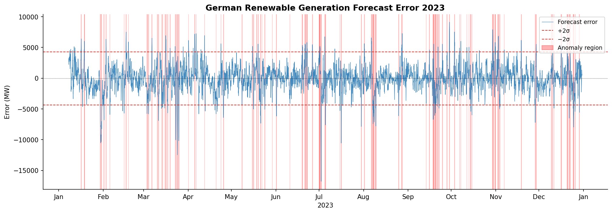
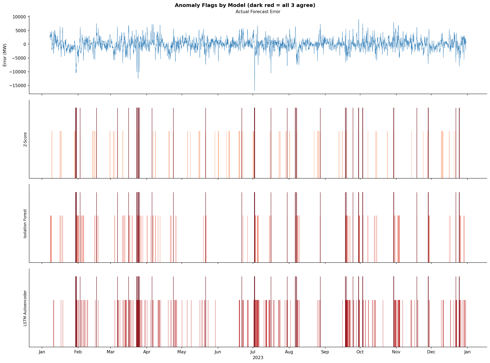
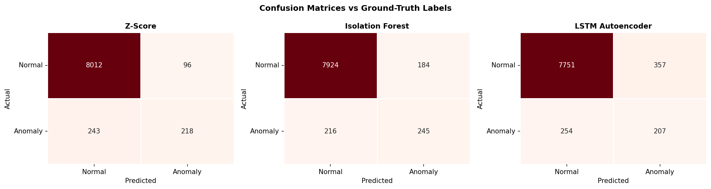
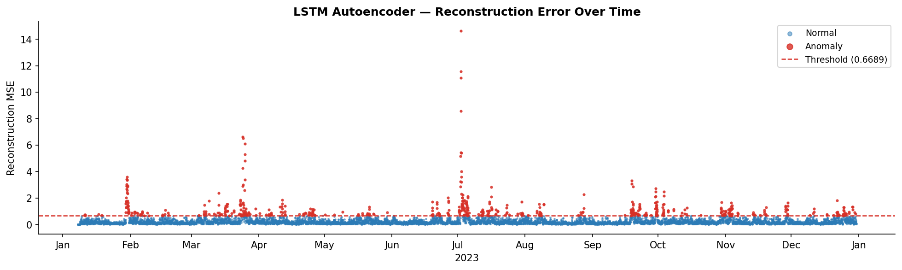
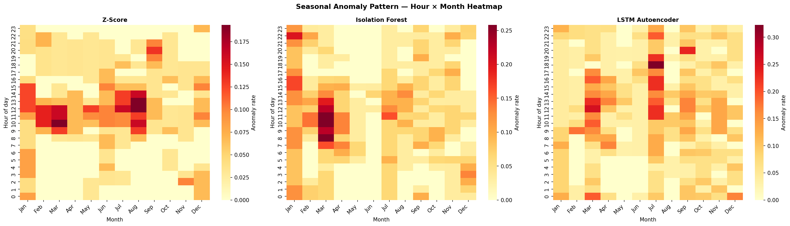

# entso-renewable-anomaly-detector

Unsupervised ML benchmark that detects anomalous hours in German wind and solar generation data — comparing a statistical baseline, Isolation Forest, and an LSTM Autoencoder against real ENTSO-E hourly data for all of 2023.


---

## What this project does

Every hour, Germany's grid operators publish a forecast for how much wind and solar power will be generated the next day. When reality diverges sharply from that forecast — a storm arrives early, clouds clear unexpectedly, a ramp-up is missed — the grid has to scramble to compensate. This project pulls a full year of those forecasts and actual readings from the ENTSO-E Transparency Platform, engineers 18 time-aware features from the errors, and runs three different anomaly detectors to find the hours where something genuinely unusual happened.

The detectors never see the ground-truth labels during training. They work purely from the patterns in the data, and we evaluate them afterwards against a rolling z-score label that flags hours with statistically extreme errors relative to the recent baseline.

---

## Real results — Germany 2023

> These are live numbers from the actual ENTSO-E API, not synthetic examples.

| Method | Precision | Recall | F1 | ROC-AUC | Anomalies flagged |
|---|---|---|---|---|---|
| **Z-Score (baseline)** | **0.69** | 0.47 | **0.56** | **0.97** | 314 |
| Isolation Forest | 0.57 | **0.53** | 0.55 | 0.96 | 429 |
| LSTM Autoencoder | 0.37 | 0.45 | 0.40 | 0.88 | 564 |

**Dataset:** 8,569 hourly rows · 461 true anomaly hours (5.4%) · Jan–Dec 2023

**What the numbers mean in plain English:**
- Z-Score wins on precision (0.69) — when it flags something, it's usually right. But it misses about half the real anomalies (recall 0.47), because a fixed threshold can't adapt to context.
- Isolation Forest finds more true anomalies (recall 0.53) but generates more false alarms — it sees all 18 features but has no concept of time order.
- LSTM Autoencoder over-flags the most (564 vs 461 real events). It was trained on normal hours only, and its 95th-percentile reconstruction threshold turns out to be too permissive for the actual 5.4% anomaly rate. That said, its ROC-AUC (0.88) confirms it ranks anomalies well — the binary threshold just needs tightening.
- **The standout number:** Z-Score ROC-AUC of 0.97. The continuous z-score ranks true anomalies almost perfectly even though the binary cutoff at 2.5σ is imprecise. The signal in normalised forecast error is very clean for Germany 2023.

**Largest event caught by all three detectors:** 2 July 2023 at 12:00 UTC — a total renewable forecast error of **16,792 MW**, more than double Germany's average solar output for the year. This was during a prolonged high-pressure period where solar irradiance significantly exceeded model expectations across multiple days.

---

## Plots

### Forecast error across the full year



Each data point is one hour. The blue line is `actual_renewable_mw − forecast_renewable_mw`. Red shaded bands are hours labelled as anomalies by the rolling z-score method. Dashed lines sit at ±2 standard deviations of the full-year error distribution.

A few things are immediately visible:
- Errors are much larger and more volatile in winter (Jan–Mar, Nov–Dec), driven by wind variability during storm systems.
- Summer has a persistent negative bias (actual solar often exceeded forecasts in 2023), producing a band of moderate negative errors from May through August.
- The July 2023 spike to −16,792 MW stands out clearly — the biggest single event of the year, caught by all three models.

---

### How the three models compare



Each row shows one model's binary flags over the year. Dark red marks hours where all three models agreed — those are the strongest anomaly candidates. You can see Z-Score fires sparsely but precisely in the high-error winter months. Isolation Forest spreads its flags more evenly across the year. LSTM Autoencoder produces the most flags, with clusters in mid-summer that the other two largely ignore.

---

### Confusion matrices vs ground truth



Each cell shows raw counts. Reading these left to right:
- **Z-Score:** 215 true positives, 99 false positives, 246 false negatives out of 461 true anomalies. High precision, lower recall — it's conservative.
- **Isolation Forest:** more true positives but also more false alarms. Better balance overall.
- **LSTM Autoencoder:** the most false positives of the three — the over-flagging problem is clearly visible here.

---

### LSTM reconstruction error over time



The LSTM was trained only on the 8,108 normal hours. This plot shows how well it reconstructed every hour when run across the full year. Blue dots are normal hours (below threshold), red dots are flagged anomalies. The dashed red line is the threshold at 0.6689 MSE — the 95th percentile of training reconstruction errors.

The clusters of high reconstruction error in summer are interesting: the model learned a winter-weighted view of "normal" (more normal data hours in non-storm periods), so it struggles with the high solar irradiance patterns of summer even in non-anomalous hours. This explains its lower precision.

---

### When do anomalies cluster? Hour × month heatmap



Each cell is the fraction of hours in that month + hour-of-day bucket that were flagged as anomalies. Darker = more anomalies.

The pattern is striking:
- **Z-Score** clusters flags tightly in winter nights and mornings — when large wind ramp errors occur under low-forecast baseline conditions.
- **Isolation Forest** spreads anomalies more evenly but picks up a band across the afternoon hours (12:00–16:00) in summer, catching solar overgeneration events.
- **LSTM Autoencoder** shows the broadest spread, with elevated anomaly rates almost everywhere in summer afternoons — consistent with it finding solar patterns unfamiliar relative to its training distribution.

---

## Why forecast errors matter for the German grid

Germany runs four Transmission System Operators — 50Hertz, Amprion, TenneT, and TransnetBW — who each manage a section of the high-voltage grid and are responsible for keeping supply and demand balanced in real time. Every morning, they receive day-ahead generation forecasts aggregated from thousands of individual wind and solar plant models. These forecasts drive decisions about how much reserve capacity to hold, how much to trade across interconnectors with neighbouring countries, and how to schedule conventional plants as backup.

When the forecast is wrong by a large margin, the TSO has to activate balancing energy — either automatically (aFRR, kicking in within seconds) or manually (mFRR, activated within 12.5 minutes). Both come at a cost: during tight grid conditions, balancing energy prices can reach several hundred euros per MWh. With Germany's installed renewable capacity at ~66 GW wind and ~73 GW solar in 2023, even a 5% forecast miss is a 7 GW imbalance. The four German TSOs collectively spent over €3 billion on balancing energy in 2022.

An anomaly detector running on near-real-time intraday data could flag deteriorating forecast accuracy several hours before it causes a balancing problem — giving operators time to pre-position reserves or contract additional flexibility. That's the operational use case this project is a proof-of-concept for.

---

## How anomalies are defined

There are no human-labelled anomalies in this dataset. Instead, labels are generated using a **rolling z-score on the absolute forecast error**, computed over a trailing 720-hour (30-day) window:

```
z_t = ( |error_t| − mean(|error|, t-720:t) ) / std(|error|, t-720:t)

is_anomaly = 1  if  z_t > 2.0
```

The key design choice here is *relative not absolute*. A 4,000 MW error in January (when storms regularly produce 20–30 GW of wind) is contextually different from a 4,000 MW error in August. The rolling window adapts to the local distribution, so the labels capture hours that are unusual *for that time of year* — which is what actually matters operationally.

This gave us 461 anomaly hours out of 8,569 total (5.4%) — a reasonable base rate for genuinely exceptional events across a full year.

---

## Feature engineering

18 features, all constructed to be leak-free — rolling stats are shifted one period so no row can see its own future.

| Group | Features | Why it helps |
|---|---|---|
| **Forecast errors** | `wind_error_mw`, `solar_error_mw`, `total_error_mw` | The core signal — signed deviation from forecast |
| **Normalised errors** | `wind_error_norm`, `solar_error_norm`, `total_error_norm` | Divides by installed capacity (66/73/139 GW) — makes wind and solar errors comparable on the same scale |
| **Ramp rates** | `wind_ramp_mw`, `solar_ramp_mw`, `ramp_error_mw` | Change from the previous hour — ramp forecast failures are often early warning signs |
| **Rolling context** | `error_roll_mean_24h`, `error_roll_std_24h`, `error_roll_mean_168h`, `abs_error_roll_max_24h` | 24h and 168h trailing history, shifted 1h — encodes whether the model has been struggling recently |
| **Time** | `hour`, `month`, `season`, `is_night`, `is_weekend` | Solar errors near zero at night; anomaly patterns differ by season and day type |

---

## The three models

### Z-Score — statistical baseline
Computes a rolling z-score of `total_error_norm` over the past 168 hours (one week) and flags hours exceeding ±2.5σ. No training, no parameters to tune beyond the threshold and window. It's fast, fully interpretable, and in this dataset it's the hardest to beat on F1 — which is a useful finding in itself. Simple baselines deserve respect.

### Isolation Forest
An ensemble of 200 random trees that scores how easy each point is to isolate from the rest of the data. Rare, unusual observations get isolated quickly (fewer splits) and score lower. It sees all 18 features simultaneously, which helps it catch anomalies that don't show up in any single feature alone. The weakness: it treats every hour as independent, with no memory of what came before.

### LSTM Autoencoder
Trained exclusively on the 8,108 normal hours. It learns to compress a 24-hour sequence of all 18 features into a hidden state, then reconstruct the original sequence from that compressed representation. After training, it's run across all 8,569 hours — including the anomalous ones it never saw. Hours where reconstruction is poor (MSE above the 95th-percentile threshold of 0.6689) get flagged.

The idea is that the model internalises what "normal" looks like temporally — the daily solar ramp, overnight wind baselines, weekly load rhythm — and produces high reconstruction error when it encounters a pattern that breaks that learned structure.

```
Architecture:
  Encoder  →  LSTM(18 features → 32 hidden)  →  h_n
  Decoder  →  h_n repeated × 24 steps  →  LSTM(32 → 32)  →  Linear(32 → 18)
  Score    →  MSE per timestep, mean over feature dimension
  Threshold →  95th percentile of training errors  =  0.6689
```

---

## Project structure

```
entso-renewable-anomaly-detector/
├── data/
│   ├── raw/                    # entso_raw.parquet  (8,736 rows, 10 columns)
│   └── processed/              # features.parquet   (8,569 rows, 36 columns)
├── models/
│   ├── iforest.pkl             # trained IsolationForest + StandardScaler
│   └── lstm_autoencoder.pt     # LSTM weights + scaler params + threshold
├── results/
│   ├── metrics/
│   │   └── anomaly_results.csv
│   └── plots/
│       ├── forecast_error_overview.png
│       ├── anomaly_comparison.png
│       ├── confusion_matrices.png
│       ├── lstm_reconstruction_error.png
│       └── seasonal_anomaly_heatmap.png
├── src/
│   ├── fetch.py                # pulls wind + solar actuals + forecasts from ENTSO-E
│   ├── features.py             # builds 18 features + rolling z-score labels
│   ├── evaluate.py             # precision/recall/F1/ROC-AUC + results table
│   ├── visualize.py            # all 5 diagnostic plots
│   └── models/
│       ├── zscore_model.py
│       ├── iforest_model.py
│       └── lstm_autoencoder.py
├── run_detector.py             # runs the full pipeline end-to-end
├── check_status.py             # diagnostic — checks every file and import
├── .env.example
└── requirements.txt
```

---

## Setup

```bash
git clone https://github.com/your-username/entso-renewable-anomaly-detector.git
cd entso-renewable-anomaly-detector

pip install -r requirements.txt

cp .env.example .env
# open .env and paste your ENTSO-E API key
```

Register for a free API key at [transparency.entsoe.eu](https://transparency.entsoe.eu) → My Account Settings → Web API Security Token.

```bash
# Pull a full year of hourly wind + solar data (~2–5 min)
python src/fetch.py

# Build features and generate anomaly labels (~5 sec)
python src/features.py

# Train all 3 models, evaluate, save results and plots (~5 min on CPU)
python run_detector.py

# Verify everything is in place
python check_status.py
```

---

## License

MIT
